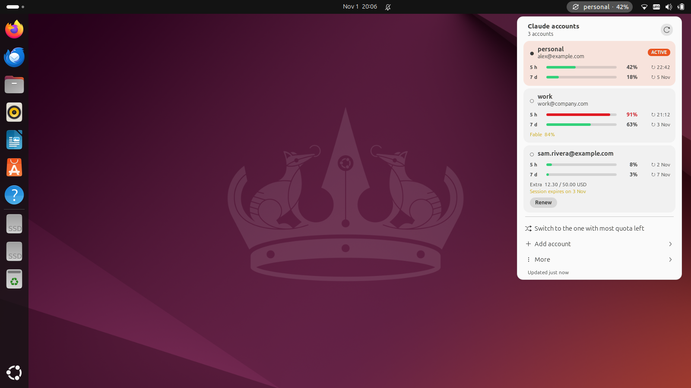
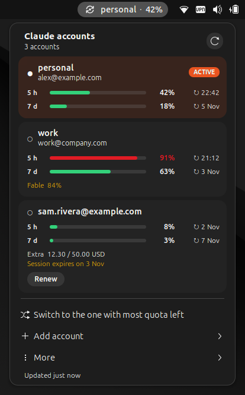
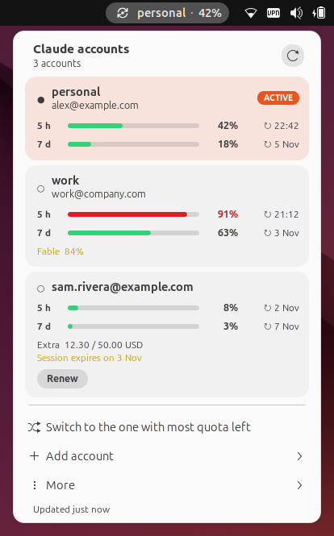
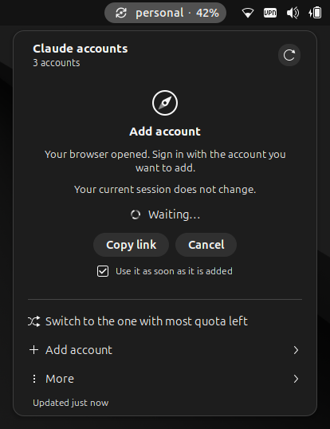
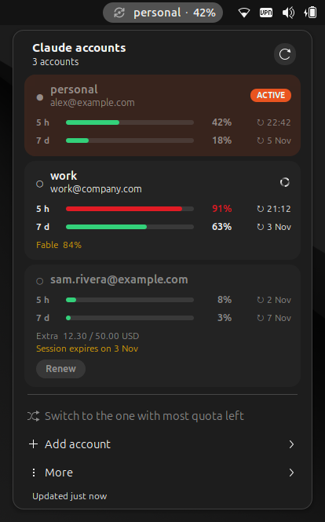
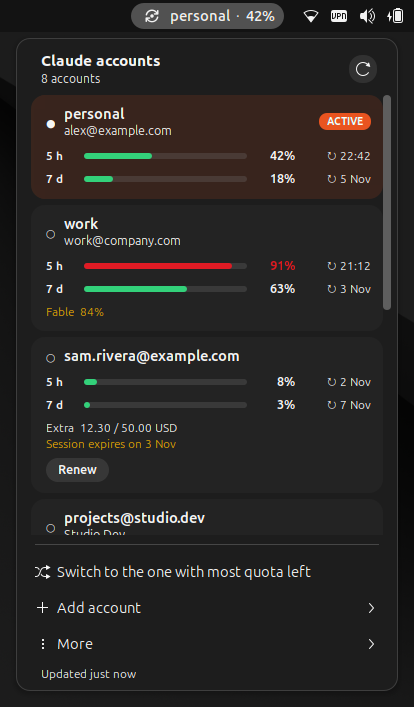
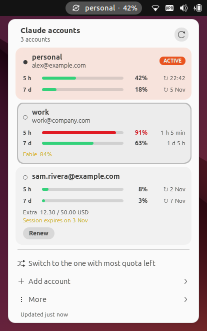
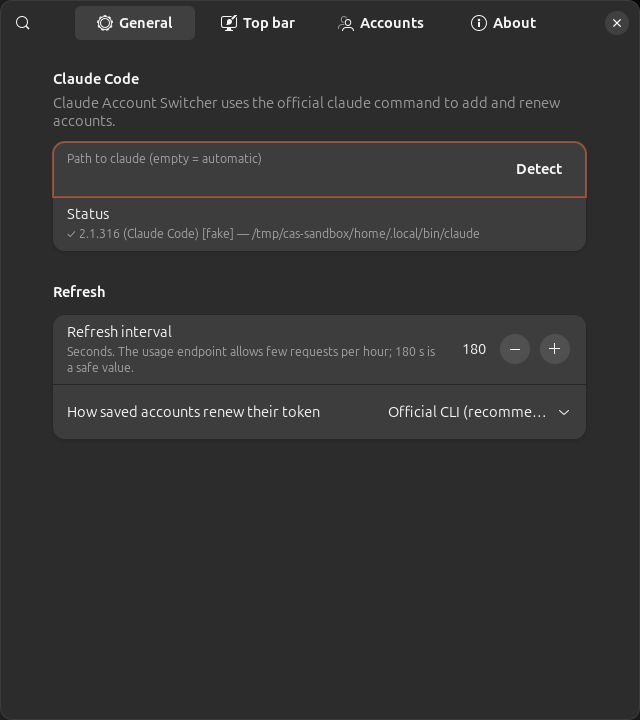
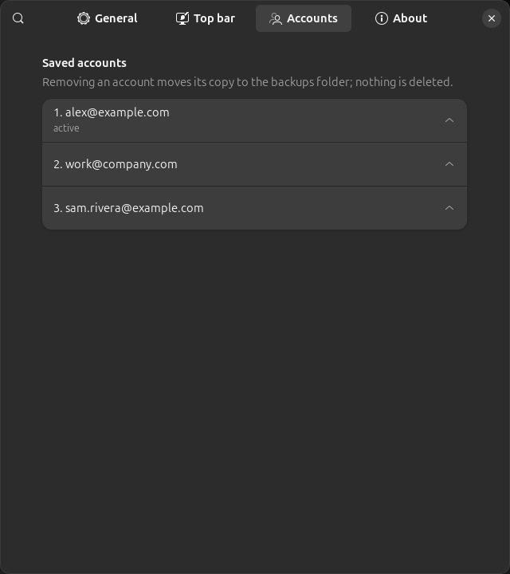

<h1 align="center">Claude Code Account Switcher for GNOME</h1>

<p align="center">
  <b>Switch between Claude Code accounts from the Ubuntu / GNOME top bar — without logging out and without losing a single open conversation.</b><br>
  See the 5-hour and weekly usage of every account at a glance. Native GNOME Shell extension, no Python, no extra tools.
</p>

<p align="center">
  <a href="https://github.com/oswaldocarabano/claude-code-account-switcher/releases/latest"></a>
  
  
  <a href="LICENSE"></a>
  
</p>

<p align="center">
  
</p>

**Claude Code Account Switcher** is a Claude Code multi-account manager for Linux. If you use several Claude Pro / Max accounts and hop between them when one hits its limit, it replaces `/logout` + `/login` with a single click — and every `claude` session you have open keeps its conversation and simply uses the new account on its next request.

## Features

- 🔀 **One-click account switching** from the top bar. Open Claude Code sessions in every terminal and tab keep their history and context.
- 📊 **5-hour and 7-day usage bars** for every account, with reset times (hover for countdowns), per-model weekly limits and extra-usage spend.
- 🎯 **"Switch to the one with most quota left"**.
- ➕ **Add accounts with the official Claude sign-in page** in your browser — your current session is never touched. Renew logins before they expire (every ~28 days).
- 🔔 **Notifications** when you switch and when an account crosses a usage threshold.
- 🛡️ **Safe by design**: follows Claude Code's own file-lock protocol, atomic `0600` writes, automatic rollback, and never discards a credential (backups go to a `stash/` folder).
- 🖥️ **Native GNOME look**: light and dark themes, your desktop accent colour, keyboard navigation, screen-reader labels.
- ⌨️ **`claude-accounts` command-line tool** with `--json` output, for scripts and other desktops.
- 🌍 English, Español, Français, 简体中文 and हिन्दी.

## Screenshots

| Dark theme | Light theme |
|:---:|:---:|
|  |  |
| **Add an account** — official browser sign-in, current session untouched | **Switching** — spinner on the target account, the menu stays open |
|  |  |
| **8 accounts** — the list scrolls | **Hover** — countdowns until each window resets |
|  |  |
| **Preferences** (libadwaita) | **Accounts page** — alias, rotation, remove |
|  |  |

<sub>Real GNOME Shell 46 screenshots from a sandbox session with example accounts.</sub>

## Install

**Requirements:** GNOME Shell 46 (Ubuntu 24.04) and [Claude Code](https://docs.anthropic.com/en/docs/claude-code). `gjs` and `gir1.2-soup-3.0` ship with Ubuntu's desktop.

### One command

```bash
curl -fsSL https://github.com/oswaldocarabano/claude-code-account-switcher/releases/latest/download/install.sh | sh -s -- --cli
```

The installer checks the requirements, downloads the latest release, installs the extension for your user only (no `sudo`) and, with `--cli`, adds the `claude-accounts` command to `~/.local/bin`.

Then **log out and back in** (Wayland cannot reload GNOME Shell in place) and, if needed:

```bash
gnome-extensions enable claude-account-switcher@oswaldocarabano.github.io
```

### Manual

Download `claude-account-switcher@oswaldocarabano.github.io.shell-extension.zip` from the [latest release](https://github.com/oswaldocarabano/claude-code-account-switcher/releases/latest), then:

```bash
sha256sum -c SHA256SUMS --ignore-missing     # optional: verify the download
gnome-extensions install --force claude-account-switcher@oswaldocarabano.github.io.shell-extension.zip
```

### From source

```bash
git clone https://github.com/oswaldocarabano/claude-code-account-switcher.git
cd claude-code-account-switcher
sh install.sh --source --cli     # builds the package from this checkout and installs it
```

(Developers with [`just`](https://github.com/casey/just) can also use `just pack` and `just install`.)

### Uninstall

```bash
curl -fsSL https://github.com/oswaldocarabano/claude-code-account-switcher/releases/latest/download/install.sh | sh -s -- --uninstall
```

Your saved accounts stay in `~/.local/share/claude-accounts`; delete that folder if you want them gone too.

## Getting started

1. Open the menu in the top bar and click **Save** to save the account Claude Code is currently signed in with.
2. **Add account → Sign in with another account…** opens the official Claude sign-in page. Log in with your other account; your current session does not change.
3. Click any account card to switch. Keep working in your open `claude` sessions — the next request uses the new account.

> **Tip:** never run `/logout` before adding an account — it can revoke the token of the account you are leaving. Use the menu instead.

## Command line

```
claude-accounts list [--cached|--force]     accounts and usage
claude-accounts switch <n|email|alias>      switch account (conversations stay open)
claude-accounts switch --best               switch to the one with most quota left
claude-accounts add --current | --login     save the current session / sign in with another account
claude-accounts alias <n> <alias>           name an account
claude-accounts disable|enable <n>          take out of / back into "most quota left"
claude-accounts remove <n>                  remove (moved to a backup folder, never deleted)
claude-accounts doctor                      diagnostics
```

Add `--json` for machine-readable output (`schemaVersion: 1`).

## How it works

```
┌──────────── GNOME Shell ─────────────┐        ┌──────── claude-accounts engine (gjs) ────────┐
│ extension: indicator, menu, prefs    │  JSON  │ saved accounts · switch · usage ·   │
│ (never touches credentials)          │◄──────►│ isolated browser login              │
└──────────────────────────────────────┘        └──────────────┬──────────────────────┘
                                                               ▼
                                   ~/.claude/.credentials.json  +  oauthAccount in ~/.claude.json
                                   (the only two things that change on a switch)
```

- A switch replaces **only** the account credential and the `oauthAccount` block. Projects, history, settings and MCP servers are never read or written, so conversations survive.
- Claude Code re-reads its credential file on every request, so running sessions pick up the new account immediately — no restart.
- The engine takes the same file locks Claude Code uses while refreshing tokens, so a switch never races a token refresh. Refresh tokens are single-use; the saved copy of the active account follows every rotation so you can always switch back without `/login`.
- Inactive accounts are renewed through the official `claude auth` CLI, in their own isolated folder.
- Usage comes from Claude's usage endpoint, kept under ~20 requests per hour per account (it rate-limits at ~30).
- Everything heavy runs in a separate short-lived process, so GNOME Shell never blocks.

## Privacy and security

- Your tokens stay on your machine: they are only sent to Anthropic's own endpoints (usage, token renewal) — no telemetry, no third parties.
- Saved accounts live in `~/.local/share/claude-accounts` (`0700`, files `0600`). Logs (`~/.local/state/claude-accounts/claude-accounts.log`) never contain tokens or emails.
- Nothing is ever deleted: replaced or unrecognised credentials are kept in `~/.local/share/claude-accounts/stash/`.

## FAQ

**Do my open Claude Code conversations really survive a switch?** Yes. Only the credential changes; the conversation lives in the running process and in `~/.claude/projects/`, which is never touched. The first request after a switch re-sends the context to the new account (prompt caches are per account).

**Does it switch automatically when I hit a limit?** No, on purpose: you decide. It notifies you when an account crosses a threshold and suggests the freest one.

**KDE / XFCE?** The extension is GNOME-only, but the `claude-accounts` command works on any desktop.

**Is this affiliated with Anthropic?** No. Claude and Claude Code are Anthropic products; this is an independent open-source tool. Make sure your use of several accounts complies with Anthropic's terms.

## Development

```bash
npm install          # eslint only
just test            # 74 tests: unit, end-to-end in a sandboxed HOME, a 1,000-rotation race, token-leak scan
just lint            # eslint with GNOME Shell's rules
just nested-sandbox  # a nested GNOME Shell with fake accounts (your real ~/.claude and settings are never touched)
just screenshots     # regenerate assets/screenshots
just pack            # build dist/claude-account-switcher@oswaldocarabano.github.io.shell-extension.zip
```

Translations live in `po/` (`python3 tools/xgettext.py` regenerates the template). Contributions in other languages are welcome.

## Credits

Built on what [claude-swap](https://github.com/realiti4/claude-swap), [CCSwitcher](https://github.com/XueshiQiao/CCSwitcher) and [Claude Bar](https://github.com/ncthanhngo/claude-bar) learned about Claude Code's session handling. See [NOTICE](NOTICE).

## License

[GPL-2.0-or-later](LICENSE).
